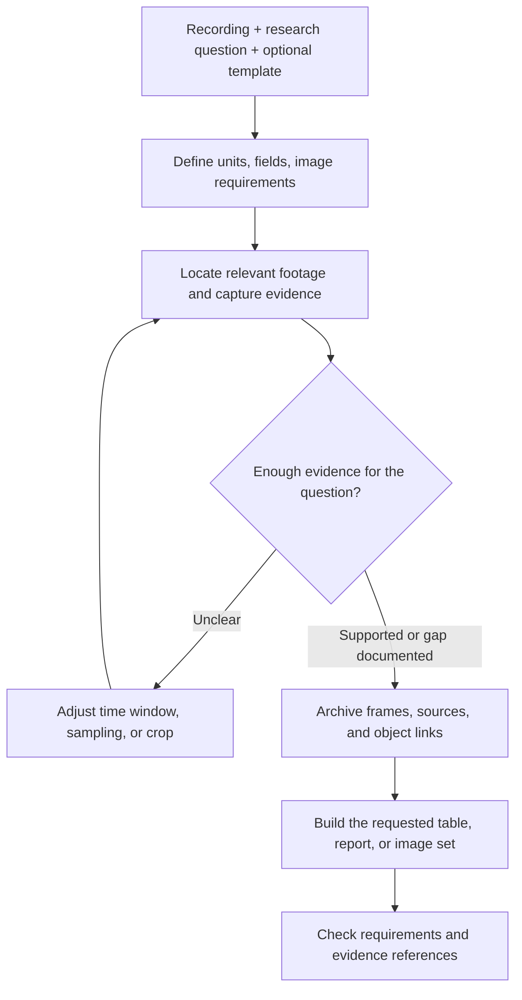

# GameLens

### Turn gameplay footage into structured, traceable game research.

[简体中文](README.zh-CN.md) · **English** · [Skill instructions](skills/gamelens/SKILL.md)

GameLens is an agent skill for game designers, analysts, and researchers who need to turn recordings into useful working material: level breakdowns, mechanic comparisons, UI walkthroughs, and spreadsheet-ready observations—linked to the frames that support them.

Give your agent a recording, a research question, and an optional reference workbook. GameLens guides it to organize the analysis around your task, revisit unclear moments, and deliver structured findings with reusable visual evidence.

> **One recording → structured observations + timestamped evidence + reusable image assets.**

## What can you do with it?

| Your task | What the workflow helps produce |
| --- | --- |
| Break down levels or encounters | Records of goals, resources, layouts, retries, and observed outcomes, with supporting frames |
| Study a mechanic | Before/after or ordered frame sequences that show how an action unfolds |
| Analyze a competitor's game | Evidence-backed notes on tutorials, progression, offers, and interface flows visible in the recording |
| Work with an existing Excel template | Field mappings and populated records that follow the template's definitions |
| Collect particular screenshots | Targeted images of requested objects, events, or states, with their source context |
| Build a reusable research library | Full frames, crops, source metadata, and links to the objects or events they describe |

The unit of analysis can be a level, turn, encounter, action, interface, or your own research object. The workflow adapts to the question and game.

## Why GameLens?

- **Fits the way you work.** Your question and reference materials determine the fields, analysis units, and image requirements. A new game does not have to fit an old game's schema.
- **Revisits the moments that matter.** When a number, transition, or mechanic is unclear, the agent adjusts the time window, sampling density, or region of interest and checks again.
- **Makes findings easier to review.** Evidence IDs link observations to sources, timestamps or frame indices, full frames, and crops. Reviewers can inspect the basis for a claim.
- **Keeps images useful beyond one report.** Independent image files and indexes support later comparisons, new reports, and revised crops without extracting pictures from a spreadsheet.
- **Keeps uncertainty visible.** Direct observations, interpretations, reference-only material, and unresolved questions remain distinct. An offer appearing on screen is not proof of a purchase.

## Quick start

### 1. Add the skill to your agent

Download or clone this repository, then copy `skills/gamelens/` into your agent's skill directory. For repository-scoped Codex use, place it at:

```text
your-project/
  .agents/skills/gamelens/
    SKILL.md
    agents/openai.yaml
    references/
```

See the [official OpenAI skill documentation](https://learn.chatgpt.com/docs/build-skills) for local skill discovery. Other hosts may use different installation locations.

### 2. Make the working tools available

This repository contains **workflow instructions, reference guides, and skill metadata**. Video capture, OCR, model inference, and report generation run through tools available to the host agent; their runtimes are not bundled here.

The agent needs access to your recording and a video toolchain that can inspect metadata, sample frames, and crop images—for example, an existing local GameLens backend or an equivalent OpenCV/FFmpeg setup. Spreadsheet tasks also require workbook tools. OCR is useful when reading on-screen text. The skill instructs the agent to inspect available interfaces before using them.

### 3. Describe the result you need

For example, in Codex CLI or the IDE extension:

```text
Use $gamelens to analyze gameplay.mp4 using template.xlsx.
Create one record per turn and preserve the template's field definitions.
Keep a full frame and a readable crop for each turn's result.
Mark anything the recording cannot establish as unknown.
Deliver the workbook and an evidence archive.
```

Or start with a narrow question:

```text
Use $gamelens to find the Boss's charge attack in gameplay.mp4.
Keep frames before the attack, at impact, and after recovery.
Explain the visible sequence and link each observation to its evidence.
```

## How it works



Three layers make the results reusable:

| Layer | What it records | Why it helps |
| --- | --- | --- |
| Task specification | Scope, analysis units, field definitions, requested images | Keeps the work aligned with your question |
| Evidence archive | Sources and hashes, timestamps/frame indices, parent frames, crops | Lets you trace an image back to its origin |
| Object and event links | Which image supports which unit, entity, requirement, or sequence | Lets different reports reuse the same evidence |

The workflow stops revisiting a question when its evidence requirements are met or a gap is documented. It does not require an exhaustive breakdown for a targeted screenshot request.

## What you receive

Deliverables follow your request. A typical evidence-backed analysis may include:

```text
Trace_Evidence_Pack/
  source_manifest.json   # Inputs, hashes, metadata, source inclusion status
  image_index.json       # Images, timestamps, parent frames, crop coordinates
  asset_links.json       # Images linked to analysis units and objects
  frames/                # Independent full frames
  crops/                 # Task-specific details
  tool_calls.jsonl       # Actual sampling and tool actions
  reports/               # Requested workbook or report
```

These are recommended conventions, not a fixed output schema. Existing equivalent indexes can be reused. The archive states whether the original recording is included.

## Potential advantages

The design aims to reduce repeated full-video review, make template changes easier, give teams a clearer basis for discussing findings, and let an evidence library accumulate value across projects. These are expected workflow benefits; this repository does not establish a measured speedup or accuracy improvement.

## Experience and limits

The included [Smash Fest case notes](skills/gamelens/references/smash-fest-lessons.md) document a 30-level recording analysis: targeted follow-up capture, template adaptation, crop corrections, and shared image mappings across Excel and HTML. They also record unresolved observations and verification limits. Game footage and workbooks are not bundled in this repository.

- Results depend on recording coverage, image quality, the available tools, and the agent's judgments. A missing event cannot be recovered from footage that never captured it.
- Visual similarity does not establish an official name or identical behavior. Screen evidence alone cannot establish retention, revenue, or advertising ROI.
- The skill defines a reviewable process; it does not guarantee event recognition, complete automation, or compatibility with every tool backend.
- The installed skill and detailed operational guides are currently written in Chinese. Both project introductions are maintained in Chinese and English.

## Explore the skill

- [Main workflow](skills/gamelens/SKILL.md)
- [Adapting tasks, Excel fields, and image requests](skills/gamelens/references/task-adaptation.md)
- [Archiving, linking, and reusing image evidence](skills/gamelens/references/image-evidence.md)
- [Lessons from the Smash Fest case](skills/gamelens/references/smash-fest-lessons.md)

If you propose an improvement, include the research goal, the expected output, and a reproducible example of the gap. This makes changes easier to assess across different games and tools.
