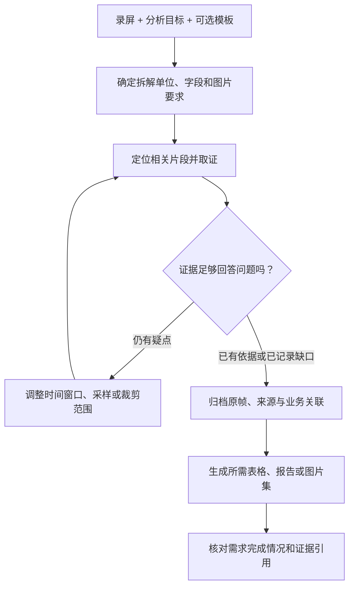

# GameLens

### 把游戏录屏，变成可复核、可复用的拆解资料。

**简体中文** · [English](README.md) · [Skill 使用规范](skills/gamelens/SKILL.md)

GameLens 是面向游戏策划、分析师和研究人员的 Agent Skill，帮助你把游戏录屏整理成真正能用于工作的资料：关卡拆解、机制对比、界面流程、Excel 分析表，以及支撑这些记录的原始画面。

提供录屏、分析目标和可选的参考表格，GameLens 会指导 Agent 按你的问题组织分析，对疑点定向补看，并把结果与截图证据关联起来。

> **一段录屏 → 结构化观察 + 带时间位置的证据 + 可持续复用的图片资产。**

## 能用它做什么？

| 你的任务 | 可以组织成的交付物 |
| --- | --- |
| 拆解关卡或战斗 | 目标、资源、布局、重试与实录结果等记录，以及对应画面 |
| 研究某个机制 | 操作前后对照、命中与恢复阶段等有序图片，及可观察到的变化 |
| 做竞品分析 | 录屏中可见的教学、进程、付费入口和界面流程，附证据与待核实项 |
| 按现有 Excel 填表 | 沿用本次模板字段定义、单位和记录粒度的分析结果 |
| 找指定图片 | 某个对象、事件或状态的完整原帧、清晰局部和来源信息 |
| 建立拆解素材库 | 可检索、可追溯、能关联到业务对象的图片与索引 |

拆解单位可以是关卡、回合、战斗阶段、操作步骤、界面，也可以是你定义的研究对象。具体拆什么、保留什么，由本次任务决定。

## 为什么用 GameLens？

- **适配你的分析方法和模板。** 根据当前问题识别记录粒度、字段口径与图片要求。换一个游戏或一张 Excel，不必沿用旧游戏的分类和字段。
- **疑点可以定向补看。** 数字模糊、过程缺帧、状态冲突时，指导 Agent 调整时间窗口、采样密度或画面区域，再检查实际返回的证据。
- **分析有依据，复核有入口。** 通过证据 ID，把观察记录关联到来源、时间或帧号、完整原帧与裁剪图，方便回看判断依据。
- **图片可以跨报告复用。** 独立保存图片及其索引。后续做新报告、对比或重新裁剪时，可以从证据资产继续工作。
- **把不确定性保留下来。** 分开记录直接观察、机制解释、仅参考素材和待核实项。例如看到购买弹窗，只能确认入口出现，不能直接写成已经购买。

## 快速开始

### 1. 把 skill 放入 Agent 的技能目录

下载或克隆本仓库，将 `skills/gamelens/` 复制到你使用的 Agent 的技能目录。以 Codex 的项目级配置为例：

```text
your-project/
  .agents/skills/gamelens/
    SKILL.md
    agents/openai.yaml
    references/
```

本地技能发现方式见 [OpenAI 官方技能文档](https://learn.chatgpt.com/docs/build-skills)。其他 Agent 的安装目录以对应产品要求为准。

### 2. 准备可用的工作工具

本仓库提供的是**工作流指令、参考规范和技能元数据**。视频取证、OCR、模型推理与报告生成由宿主 Agent 可调用的工具完成，仓库不包含这些运行时。

Agent 需要能读取录屏，并有查询视频元数据、抽帧和裁剪图片的工具，例如已有的本地 GameLens 后端，或等价的 OpenCV / FFmpeg 工具链。Excel 任务还需要表格处理能力；识读画面文字时可使用 OCR。Skill 会要求 Agent 先检查真实可用的接口再执行。

### 3. 直接描述你需要的结果

例如在 Codex CLI 或 IDE 扩展中：

```text
使用 $gamelens，按 template.xlsx 拆解 gameplay.mp4。
每行一个回合，保留模板的字段含义和计量口径。
每个回合结果保留完整原帧和清晰局部图。
录屏无法确认的内容标为未知。
交付分析工作簿和可追溯的证据包。
```

也可以只回答一个具体问题：

```text
使用 $gamelens，找出 gameplay.mp4 中 Boss 的蓄力攻击。
分别保留攻击前、命中时和恢复后的图片。
说明画面中能确认的过程，并关联每条观察的证据。
```

## 它是怎么工作的？



复用能力来自三层组织：

| 层次 | 记录什么 | 带来的用途 |
| --- | --- | --- |
| 任务规格 | 范围、拆解单位、字段定义和图片要求 | 让分析与当前问题保持一致 |
| 证据归档 | 来源与哈希、时间或帧号、父原帧、裁剪区域 | 让每张分析图片有来源可查 |
| 业务关联 | 图片对应的对象、事件、需求和序列关系 | 让不同报告复用同一份证据 |

某个问题得到足够证据，或确认无法从录屏回答后，就停止为它补看。局部图片需求可以直接定向处理，无需自动扩展为整段视频的完整拆解。

## 最后能拿到什么？

交付内容以你的要求为准。一次带证据的拆解通常可以组织为：

```text
Trace_Evidence_Pack/
  source_manifest.json   # 输入来源、哈希、元数据及是否随包提供
  image_index.json       # 图片、时间、父原帧和裁剪坐标
  asset_links.json       # 图片与拆解单位、业务对象的关联
  frames/                # 独立完整原帧
  crops/                 # 本次任务需要的细节图
  tool_calls.jsonl       # 实际采样与工具操作记录
  reports/               # 按需生成的工作簿或报告
```

这是推荐组织方式，已有的等价索引可以继续使用。证据包会说明是否包含原视频；有截图不代表包内一定能回放原视频。

## 潜在优势

这套设计希望减少反复通看视频的工作量，降低更换模板时的整理成本，让团队围绕可见证据讨论，并让素材库随着项目积累持续发挥价值。这些是机制带来的预期收益，本仓库尚未提供量化的提速或准确率对照实验。

## 实际经验与能力边界

仓库内的 [Smash Fest 案例记录](skills/gamelens/references/smash-fest-lessons.md) 来自前 30 关录屏拆解，涵盖定向补看、模板适配、裁剪修订，以及 Excel 与 HTML 共用图片映射的经验，也保留了待核实项和验证限制。实际游戏录屏和工作簿未随本仓库发布。

- 结果受录屏覆盖范围、画质、可用工具和 Agent 判断影响；录屏没有拍到的事件，需要额外来源才能确认。
- 外观相似不能直接证明官方名称或机制相同；仅凭画面不能确认真实留存、收入或投放 ROI。
- Skill 定义可复核的工作流程，不保证识别准确率、全自动完成，或与所有工具后端兼容。
- 当前技能主体与详细操作规范使用中文；项目介绍同时提供中文版和英文版。

## 进一步了解

- [主工作流](skills/gamelens/SKILL.md)
- [如何适配任务、Excel 字段与指定图片](skills/gamelens/references/task-adaptation.md)
- [图片如何归档、关联与复用](skills/gamelens/references/image-evidence.md)
- [Smash Fest 案例经验](skills/gamelens/references/smash-fest-lessons.md)

提出改进建议时，欢迎附上分析目标、期望结果和可复现的问题示例，便于判断改动是否适用于不同游戏与工具环境。
